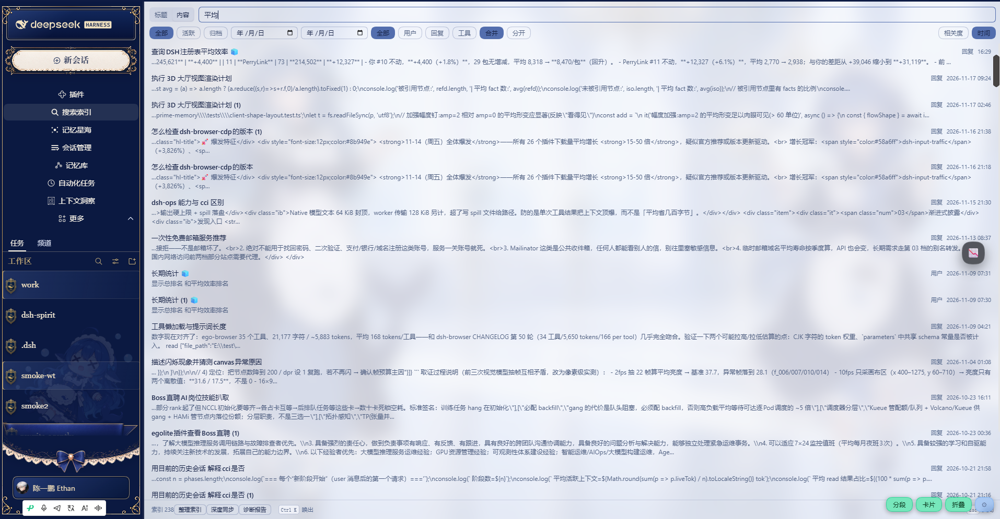

> **Note (0.7.0)**: this translation lags behind `README.md` / `README.en.md`. The 0.7.0 changes (DRS hard dependency, 017 dual-form entry, namespace `switch-search`) are documented there.

<p align="center">
  <strong>Uma busca de sessões com índice próprio para a barra lateral do DeepSeek Harness — alternância em um clique entre título e conteúdo, com filtros por usuário / resposta / ferramenta</strong>
</p>
<p align="center">
  <a href="README.md">简体中文</a> · <a href="README.en.md">English</a> · <a href="README.fr.md">Français</a> · <a href="README.de.md">Deutsch</a> · <a href="README.it.md">Italiano</a> · <a href="README.ru.md">Русский</a> · <a href="README.es.md">Español</a> · <strong>Português</strong>
</p>
<p align="center">
  <a href="LICENSE"></a>
  
</p>

# dsh-search-index

> **Índice de busca** para a barra lateral do web do DSH: adiciona ao rodapé da barra lateral uma entrada **«Buscar»** cujo painel flutuante alterna em um clique entre **busca por título ↔ busca por conteúdo**; o modo conteúdo mostra títulos e trechos encontrados **agrupados por sessão**, com filtragem por categoria **usuário / resposta / ferramenta**. Vem com um **índice independente** (sem depender do índice de texto completo oficial do DSH), com sincronização incremental, reorganização não destrutiva e exportação/importação de instantâneos.

> **Este pacote cuida apenas da busca e do índice.** A consulta e a limpeza do histórico de sessões (o antigo painel de «sessões arquivadas») foram transferidas para a aba «Sala de arquivos» do **`dsh-session-steward`**; este pacote continua **lendo** o conjunto de arquivamento oficial para excluir do índice as sessões arquivadas, mas já não **escreve** nele — o conjunto de arquivamento tem um único escritor: o steward. O contrato está descrito em `dsh-归档文件格式契约-20260914.md`.

Sem modificar o código-fonte do dsh e sem PR: um cliente cordis mais a metade anfitriã do plugin, montados pelo comando `dsh plugin` e um patch de bundle.

## Predecessor e versão atual

**Predecessor: `dsh-session-search-toggle`.** Aquela versão se apoiava no `defineStore` do `@deepseek-ai/dsh-client-runtime` para obter o assento da linha de configurações. O DSH 0.1.2 renomeou e reestruturou os pacotes motor do cliente (`dsh-client-runtime` → `dsh-client-store`), e o código antigo já não podia ser carregado no novo host — um único plugin não conseguia cobrir as duas versões com um único artefato.

**A versão atual (`dsh-search-index` 0.6.6) toma DSH 0.2.0–0.2.1-rc.2 como linha principal** (peer `0.2.0-rc.1 || 0.2.0-rc.2 || 0.2.1-rc.1 || 0.2.1-rc.2 || 0.2.1-rc.3`). As linhas de hosts históricos são atendidas por linhas de versões separadas: o DSH 0.1.7 é atendido pela 0.5.7 (dist-tag npm `dsh-0.1.7`, branch `compat/0.1.7`); os hosts 0.1.1/0.1.2 mais antigos usam o artefato antigo, que já não evolui com esta versão. Antecedentes históricos:

- **Um único artefato, adaptável em tempo de execução**: o mesmo `lib/client.js` é carregado tanto no 0.1.1-rc.2 quanto no 0.1.2-rc.1, **sem nenhuma ramificação por cadeias de versão**. O bundle do cliente só faz `require` de `react` / `react-dom`, ambos presentes na tabela de módulos compartilhada das duas versões.
- **Nenhum dos dois pacotes motor é importado**: nem `dsh-client-runtime` nem `dsh-client-store` — a renomeação, portanto, **não pode afetá-lo**.
- **Assento store implementado localmente**: a linha de configurações precisa de um assento store (`StoreHandle` / `StoreInstance`, contrato de propriedade do `@deepseek-ai/dsh-client-ui-slots` e idêntico nas duas versões). Este plugin substitui o `defineStore` por uma implementação local de trinta e poucas linhas — depende apenas de `create()` → `{ actions, getSnapshot, subscribe, clearPersisted }`, sem nenhum specifier atrelado a uma versão.
- **Todos os demais contratos coincidem nas duas versões**: o slot `settings.general.item`, `SettingsScope.{getSnapshot,subscribe,set,unset}` e as três caras de consulta do `sessionQuery` têm as mesmas assinaturas nas duas.

> **▼ Suporte a versões do DSH**
> | Versão do DSH | Estado | Suporte e diferença-chave |
> | --- | --- | --- |
> | 0.2.0-rc.1 | ✅ | **esta versão 0.6.6**; peer/engines = `0.2.0-rc.1 || 0.2.0-rc.2 || 0.2.1-rc.1 || 0.2.1-rc.2 || 0.2.1-rc.3`, zero mudanças de código (consumo puramente caller dos assentos slots/locale/configForms) |
> | 0.2.1-rc.1 | ✅ | **esta versão 0.6.6**; desde 0.2.1-a.2 o host renomeou `webRuntime` para `webStartup` — esta versão injeta `webStartup` com cadeia de reserva de nome duplo |
> | 0.2.1-rc.2 | ✅ | **versão atual 0.6.6**; adenda declarativa da enumeração (todos os peers do host verificados no rc.2 via npm), zero mudanças de código |
> | 0.1.7-rc.1+ | ✅ | 0.5.7 (dist-tag `dsh-0.1.7`); configForms resolve o handle pelo entry id, os hosts antigos recaem no settingsScope vinculado por namespace |
> | 0.1.1-rc.2 | ✅ (artefato antigo, congelado) | o motor store está em `@deepseek-ai/dsh-client-runtime/client` |
> | 0.1.2-rc.1 | ✅ (artefato antigo, congelado) | o motor passou a se chamar `@deepseek-ai/dsh-client-store`; este plugin não importa nenhum dos dois |

**Atualização a partir do nome antigo**: este pacote procede do renomear de `dsh-session-search-toggle`; o id de registro do cliente, o id de patch cordis e a URL do repositório foram renomeados junto. O GitHub mantém redirecionamentos para repositórios renomeados, então o nome antigo continua resolvendo — mas passe a dependência do perfil para o nome novo em vez de deixar os dois coexistirem muito tempo:

```sh
dsh plugin --profile web add github:drscrewdriver/dsh-search-index#master
dsh plugin --profile web remove dsh-session-search-toggle
dsh web   # reiniciar
```

O namespace de configurações continua sendo `switch-search` (**a chave de armazenamento permanece estável, sem migração**), de modo que a configuração existente continua funcionando sob o pacote novo.

## O que sabe fazer

- **Duplo modo título ↔ conteúdo**: uma entrada, duas maneiras de buscar — «Título» filtra ao vivo por substring do título da sessão / diretório de trabalho; «Conteúdo» busca no corpo das mensagens através do **índice independente construído por este plugin**.
- **Conteúdo agrupado por sessão**: cada resultado da busca por conteúdo ocupa uma linha por sessão (título da sessão + trecho mais relevante + etiqueta de tipo); um clique abre aquela sessão, sem inundar a tela mensagem a mensagem.
- **Filtro por tipo de conteúdo**: chips de filtro no cabeçalho do modo conteúdo — **Todos / Usuário / Resposta / Ferramenta**; `Ferramenta` abre aos resultados os eventos `tool/call` e `tool/result`, para buscar diretamente nos argumentos e valores de retorno das chamadas de ferramentas.
- **Ordenação de resultados**: **Relevância / Data** à direita da mesma linha — «Data» ordena pela **última atividade da sessão**, as tocadas mais recentemente primeiro; a preferência é salva em local e sobrevive aos recarregamentos. Cada resultado entrega simultaneamente a marca de tempo do documento e a da sessão, então o front-end pode reordenar por conta própria.
- **Títulos em tempo real**: o host assina `session/event`; um renomear (`session/title`) é dobrado no índice na hora, sem esperar a próxima rodada de sincronização (30 s por padrão).
- **Cartão de configurações**: Configurações → Plugins ganha um cartão **«Índice de busca»** — interruptor de ativação, modo de busca padrão, controles de sincronização / retenção / diretório do índice independente e o bloco de ciclo de vida do índice (estado, reorganização não destrutiva, exportação/importação de instantâneos). Quando informa «N sessão(ões) arquivada(s) excluída(s)», **aponta no próprio local quem responde**: consultar e limpar as sessões arquivadas cabe ao **«mordomo de sessões»** (`dsh-session-steward`), e este plugin só lê o conjunto de arquivamento; se ele não estiver instalado, o aviso diz expressamente («atualmente não instalado») — o veredicto é emitido pelo host resolvendo a partir do **grafo de módulos do próprio plugin**, e diante de um resultado indeterminado vale o texto neutro: **nunca se informa «ilegível» como «não instalado»**.
- **Tecla de invocação e pistas de teclas por plataforma**: tanto a entrada da barra lateral quanto a barra de teclas do rodapé do painel mostram a tecla de invocação — `⌘K` no macOS, `Ctrl K` no Windows/Linux, decidido conforme o sistema em execução; a tecla de fechamento do painel também segue a plataforma (`esc` no macOS, `Esc` nos demais). A detecção degrada em cascata **UA-CH → `navigator.platform` → string UA**, de modo que um modo privado nunca rebaixa um usuário de Mac aos símbolos do Windows. **O aviso e o link saem da mesma fonte**: o acorde escrito na pílula é exatamente o que o gerenciador de `keydown` reconhece — nunca «uma tecla prometida, outra interceptada».
- **Salto direto ao clicar**: clicar em um resultado abre a sessão correspondente, posicionando-se no contexto onde está o achado.

## Prévia da interface

Disposição da entrada de busca na barra lateral e do painel de busca:



## O índice independente: três mecanismos

O modo conteúdo **constrói sua própria base**, sem depender do índice de texto completo oficial `session-query-sqlite` do DSH. O índice vive em `src/host/`: `schema.ts` cria as tabelas (incluída a tabela FTS5 própria `docs_fts`), `engine.ts` executa as consultas e `extract.ts` extrai dos eventos de sessão o texto pesquisável (incluindo o nome e os argumentos da ferramenta em `tool/call`, e o texto do resultado em `tool/result` — a base de dados do «filtro de ferramentas»). O `sessionQuery` do DSH é usado apenas como **leitor de corpus** (`listSessions` / `readSession`), nunca como backend de busca.

### 1. Um índice independente do conteúdo das sessões

O índice é o **arquivo SQLite próprio deste plugin**, sem interferir de forma alguma no índice oficial. Diretório de persistência configurável, exportação/importação por instantâneo e reconstrução completa possíveis. Ao ser ativado, o host inspeciona o diretório do índice: um `index.building.sqlite` inacabado quando existe um índice ativo é interpretado como «a última reconstrução não chegou ao fim» e simplesmente é descartado; se faltar o índice ativo, o parecer é «a falha caiu na janela de renomeação» e o arquivo mais recente é restaurado como ativo.

### 2. As sessões inservíveis são depuradas pelo arquivo, com atualização contínua

`archive-source.ts` lê `global.archivedSessionIds` do centro de armazenamento oficial `~/.dsh/storages/workspace.json` e mantém **as sessões arquivadas (ou seja, inservíveis) fora do índice**. O conjunto de arquivamento tem um único escritor — o steward; este pacote limita-se a lê-lo.

A sincronização é **corrente**: `SwitchWatermarkSync` em `sync.ts` mantém uma marca de água `version` por sessão e a cada passada só compara diferenças e só reingere as sessões alteradas — nunca uma reconstrução total. Os próprios arquivos de índice são conservados em um número limitado de cópias conforme `archiveKeep`, e os mais velhos são retirados automaticamente.

### 3. A limpeza nunca estorva o índice em serviço

A limpeza passa por um **índice sombra**: `rebuild.ts` constrói o `index.building.sqlite` do zero ao lado do índice ativo, e durante toda a construção **o índice ativo continua atendendo as buscas** — nenhuma consulta fica bloqueada. Ao terminar, a troca são três `rename` síncronos (ativo → arquivamento, sombra → ativo): uma única janela atômica.

Daí a semântica de falhas: **sombra presente + ativo presente = construção inacabada**; a sombra é então um resíduo e é descartada sem cerimônia — o índice ativo nunca esteve em risco.

## Instalação

> **Nota para DSH NEXT (desktop):** o host desktop responde às requisições que não vêm do renderer com `403 Browser access is disabled`, então a busca de conteúdo usa automaticamente o canal em processo somente leitura (`contentTransport: auto`). Não há nada a instalar à parte: `dsh-reference-session-collector` chega como dependência normal. Atenção: instalado ≠ ativado — se o cartão mostrar `drs-not-activated` (rota 404), execute `dsh plugin --profile <name> add dsh-reference-session-collector` e reinicie o host.

```sh
# Opção 1: instalação direta do GitHub (recomendada) — lib/ está enviado ao repo, sem compilação local
dsh plugin --profile web add github:drscrewdriver/dsh-search-index#master

# Opção 2: montagem a partir de uma rota local / do código-fonte (veja a seção «Desenvolvimento»)

# Reiniciar dsh web — imprescindível! Uma instância em execução não recarrega a quente a camada de bundle
dsh web
```

Após a instalação aparece no rodapé da barra lateral um botão **«Buscar»**; Configurações → Plugins ganha o cartão **«Índice de busca»**.

> ⚠️ **Alcançabilidade do GitHub**: a instalação via github: pressupõe que github.com seja acessível; em uma rede com restrições, configure antes um proxy ou espelho funcional, ou o `add` ficará pendurado na fase de download.

## Desenvolvimento

```sh
pnpm install            # inclui a cadeia de pacotes cliente @deepseek-ai + tsdown/tsc
pnpm typecheck          # tsc --noEmit
pnpm build              # tsc(lib/types) + tsdown(lib/index.mjs + lib/client.js)
```

### Estrutura das fontes

```
src/
├── index.ts            # metade anfitriã (node): esquema Config + installSettingsSection + rotas
├── config.ts           # configuração pura compartilhada (enabled/defaultMode + constante de namespace, sem schemastery para o cliente)
├── host/               # o índice independente (lado anfitrião)
│   ├── schema.ts       # tabelas: docs / docs_fts(FTS5) / sessions / marcas de água
│   ├── engine.ts       # consultas
│   ├── extract.ts      # extrai o texto pesquisável dos eventos de sessão (incluídos tool/call e tool/result)
│   ├── sync.ts         # SwitchWatermarkSync: sincronização incremental corrente por marca de água de versão
│   ├── rebuild.ts      # construção sombra + troca atômica + inspeção de recuperação após falha
│   ├── archive-source.ts  # lê o conjunto de arquivamento para excluir do índice as sessões arquivadas
│   └── snapshot.ts     # exportação/importação de instantâneos
└── client/
    └── index.ts        # metade navegador: entrada sidebar.footer.action + painel flutuante + linha settings.general.item
```

- **Metade anfitriã**: registra a rota HTTP delimitada `/switch-search/api` (`list-sessions` / `content-search` / `search-status`), com uma barreira de confiança do navegador idêntica ao gateway `/api` do DSH (Host em loopback ou trustedHosts; cross-site rejeitado).
- **Padrão de configuração**: o host registra o namespace `switch-search` pelo serviço `settings` + um `Config` de schemastery; a metade cliente o lê e o escreve espelhado com um assento store local + `settingsScope.bind`; o módulo puro compartilhado `src/config.ts` mantém o bundle do cliente livre de schemastery.
- **Cadeia de compilação**: o tsdown reproduz a semântica de `packages/client/tsdown.client.ts` do harness (banner `__ModuleLoader__.load`, tabela de externals por plataforma, cancela de pureza do bundle).
- **lib/ enviado ao repositório**: as instalações do GitHub funcionam com o artefato de compilação já enviado (dsh não executa `prepare` numa instalação do git); o `.gitignore` não exclui `lib/`.

## Relação com a busca oficial da barra lateral

- A caixa de busca oficial vive em `sidebar.workspaces` (slot único) que um plugin externo **não pode substituir**; este plugin **adiciona uma entrada distinta** ao rodapé da barra lateral via `sidebar.footer.action` — ambas coexistem sem estorvar-se.
- A busca de conteúdo oficial está fixada a fogo no apiproxy e só cobre `user/message` + `assistant/message`; este plugin consulta seu próprio índice e abre `tool/call` + `tool/result`, para uma busca em nível de ferramentas.

## Compatibilidade e privacidade

- Requer DeepSeek Harness instalado com o perfil web; **nenhum código oficial é modificado**. O índice é o arquivo próprio deste plugin: estar ou não ativo o `session-query-sqlite` oficial não tem efeito algum.
- A configuração vive apenas no namespace settings do DSH e no estado do painel do navegador; nada além dos dados de busca de sessões é lido ou enviado.
- Os tipos de contrato anfitrião/cliente são declarados estruturalmente em `src/*.ts` (a cadeia de pacotes cliente dsh no npm está incompleta) e verificados contra as fontes do harness em tempo de compilação.

## A família de plugins DSH de drscrewdriver

Este projeto é um dos plugins DSH mantidos por [drscrewdriver](https://github.com/drscrewdriver). Se este lhe for útil, é provável que os demais também sejam:

| Plugin | Em uma linha |
|---|---|
| [dsh-input-traffic](https://github.com/drscrewdriver/dsh-input-traffic) | Fila de entrada em horários de pico para o DSH Web GUI: controle de tráfego de três níveis, reordenação arrastando, congelamento de sessões |
| [dsh-thinking-levels](https://github.com/drscrewdriver/dsh-thinking-levels) | Controle do reasoning_effort turno a turno: planejamento Auto inteligente ou nível fixo manual |
| [dsh-seatbelt-sandbox](https://github.com/drscrewdriver/dsh-seatbelt-sandbox) | Adaptador de sandbox Seatbelt do macOS: carregador nativo libsandbox, sucessor do sandbox-exec depreciado |
| [dsh-prime-memory](https://github.com/drscrewdriver/dsh-prime-memory) | Memória destilada em camadas: destilação automática L0~L3, injeção da lembrança antes de cada passo do modelo |
| **[dsh-search-index](https://github.com/drscrewdriver/dsh-search-index)** | Busca de sessões na barra lateral: alternância título/conteúdo, filtro por usuário/resposta/ferramenta |

## License

MIT
